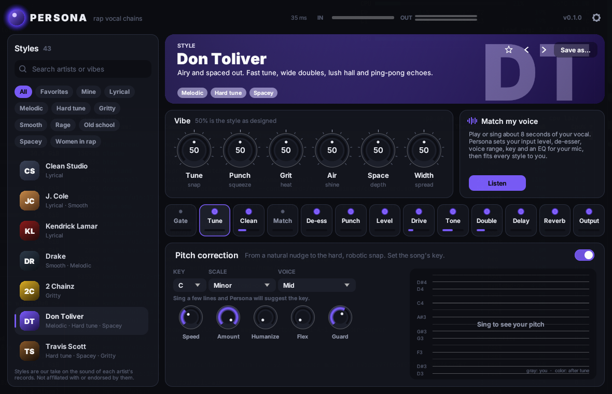
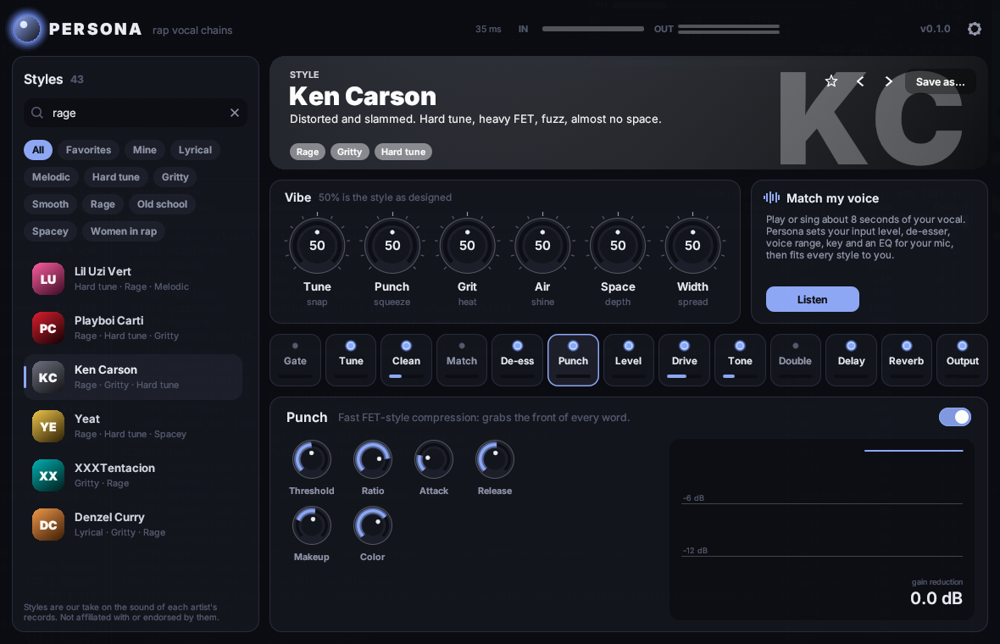
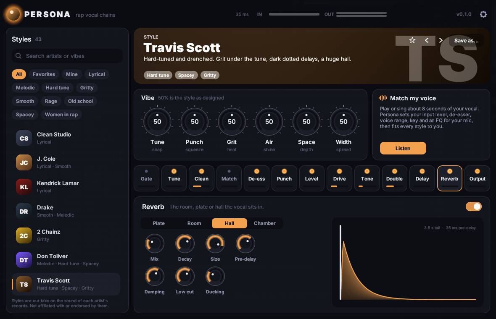

# Persona

A vocal plugin (VST3 + CLAP) for rap: pick an artist's style and Persona sets up the whole vocal
chain to sound like their records. Tune, clean-up EQ, de-esser, two compressors, saturation, tone,
doubler, delay and reverb, all in one window, all editable.

Want the vibe of J. Cole? Warm, natural, up close. 2 Chainz? Big, loud and gritty. Don Toliver?
Fast tune, wide doubles, a lush hall. There are 40 artist styles plus three utility chains, and
you can save your own.



## Styles

| Vibe | Styles |
| --- | --- |
| Lyrical | J. Cole, Kendrick Lamar, Eminem, Nas, Jay-Z, Lil Wayne, Tyler, the Creator, Denzel Curry, Mac Miller |
| Melodic | Drake, Lil Baby, Gunna, Young Thug, Juice WRLD, Post Malone, Lil Durk, Rod Wave, Kid Cudi, A$AP Rocky |
| Hard tune | Travis Scott, Don Toliver, Future, Lil Uzi Vert, Kanye West (808s), Trippie Redd, NBA YoungBoy, Yeat |
| Rage | Playboi Carti, Ken Carson, Yeat, Lil Uzi Vert, XXXTentacion, Denzel Curry |
| Gritty | 2 Chainz, Pop Smoke, 21 Savage, 50 Cent, Lil Wayne, Tyler, the Creator, Future |
| Smooth / old school | Snoop Dogg, Nas, Jay-Z, Mac Miller, Kid Cudi |
| Women in rap | Nicki Minaj, Megan Thee Stallion, Doja Cat, Cardi B, Ice Spice |
| Utility | Clean Studio (the default), Telephone Hook, Ad-lib Space |

Styles are our reading of the vocal sound on each artist's records, made as starting points. Persona
isn't affiliated with or endorsed by any of them.

Every style is level-matched: on a vocal at the level the styles are designed for (about -18 dBFS
average), each one comes out within a dB of how it went in, so you compare styles by their sound,
not by their volume.



## What's in the window

- **Style browser**: search by artist or vibe ("rage", "airy", "dark"), filter by tag, star your
  favorites, and keep your own presets under *Mine*.
- **Vibe knobs**: six big knobs that bend the loaded style without touching its settings. 50% is
  the style as designed.
  - *Tune*: how hard the pitch snaps.
  - *Punch*: more or less compression; the loudness stays put.
  - *Grit*: saturation and edge.
  - *Air*: top-end shine.
  - *Space*: how much echo and room.
  - *Width*: doubles and spread.

  Grit, Space and Width fade their module in even when the style has it switched off.
- **Match my voice**: press *Listen* and play (or sing) about 8 seconds of your vocal. Persona
  measures it and does the following:
  - sets your input level;
  - makes the de-esser work harder or ease off for how sharp your S sounds are;
  - picks the voice range for the tuner;
  - suggests the song's key;
  - learns an EQ that evens out your mic and room.

  Every style you load afterwards is fitted to your voice. *Undo* puts everything back.
- **The chain**: a strip of every module in signal order, lit when it's working, with live gain
  reduction and tune meters. Click a module to edit it, double-click to switch it on or off.
  - **Gate**: noise and bleed between phrases.
  - **Tune**: pitch correction with key, scale (10 scales), voice range, speed, amount, humanize,
    flex and consonant guard. It shows your pitch and the corrected pitch live, and suggests the
    key it hears.
  - **Clean** (high-pass, mud, harshness), **Match** (8-band learned EQ), **De-ess**.
  - **Punch** (FET-style compressor) and **Level** (opto-style leveller).
  - **Drive**: tape, tube, fuzz, phone and lo-fi saturation; all but lo-fi run 2× oversampled.
  - **Tone**: body, presence and air.
  - **Double**: two detuned copies left and right.
  - **Delay**: tempo-synced to your DAW, ping-pong, filtered, ducks while you're rapping.
  - **Reverb**: plate, room, hall, chamber, also ducked.
  - **Output**: input, output, dry/wet mix, style trim and a peak limiter.
- Latency is reported to your DAW, so the vocal stays in time. It's about 2 ms, and 18 to 48 ms
  while Tune is on, depending on the voice range.



## Install

Download the zip for your system from the [latest release](https://github.com/GPTmadeit/persona/releases/latest).

**Windows**: unzip, then copy `Persona.vst3` to `C:\Program Files\Common Files\VST3` and
`Persona.clap` to `C:\Program Files\Common Files\CLAP`. Rescan plugins in your DAW. In FL Studio
that's *Options > Manage plugins > Find installed plugins*. Then put Persona on your vocal's mixer
insert.

**macOS**: copy `Persona.vst3` to `~/Library/Audio/Plug-Ins/VST3` and `Persona.clap` to
`~/Library/Audio/Plug-Ins/CLAP`. The build isn't notarized, so run
`xattr -dr com.apple.quarantine ~/Library/Audio/Plug-Ins/VST3/Persona.vst3` (and the same for the
CLAP) once before scanning.

**Linux**: copy them to `~/.vst3` and `~/.clap`.

## Using it

1. Put Persona on the vocal track (mono or stereo).
2. Press **Listen** under *Match my voice* and play a verse. This sets your level and fits the
   chain to your voice.
3. Pick a style. Use the arrows next to its name to step through them.
4. Shape it with the vibe knobs. Edit any module for the details: the style shows *Edited*, and
   *Revert* takes you back.
5. If you use Tune, set the song's key in the Tune module, or click the key Persona heard.
6. **Save as…** keeps your version as a preset.

Knobs: drag up and down, hold Shift for fine moves, scroll to nudge, double-click to reset. Every
control can be automated.

Your presets are JSON files in `%APPDATA%\Persona\Presets` on Windows,
`~/Library/Application Support/Persona/Presets` on macOS and `~/.config/Persona/Presets` on Linux.
Your project always remembers the exact settings, whether or not they came from a style.

## Updates

Persona checks GitHub for a new release when it opens. You can turn this off under the gear icon.
When there is one, an *Update* button appears in the header. It downloads the release, verifies
its checksum, replaces the installed plugin files, and the new version loads the next time your
DAW starts. If the plugin folder needs admin rights (Program Files), close the DAW and copy the
new files in by hand instead.

## Building

```sh
cargo xtask bundle persona --release      # target/bundled/Persona.{vst3,clap}
cargo test --release
cargo run -p render --release -- target/bundled/Persona.clap   # Linux: every style through the real plugin
cargo run --release --features standalone -- --backend dummy   # UI without a DAW
```

The styles' compressor thresholds and trims are calibrated against a test vocal. After changing
the DSP or a style, re-run
`cargo test --release --lib calibrate -- --ignored --nocapture | python3 tools/apply_calibration.py`.

## Credits

- Pitch detection, key detection and PSOLA pitch shifting are ported from
  [HelixTune](https://github.com/GPTmadeit/HelixTune) (MIT, `licenses/HelixTune.txt`).
- Built with [nih-plug](https://github.com/robbert-vdh/nih-plug), [egui](https://github.com/emilk/egui)
  and [RustFFT](https://github.com/ejmahler/RustFFT).
- [Inter](https://rsms.me/inter/) typeface by Rasmus Andersson, SIL Open Font License
  (`assets/fonts/OFL.txt`).

Licensed under the GPL-3.0-or-later (required by the VST3 bindings).
