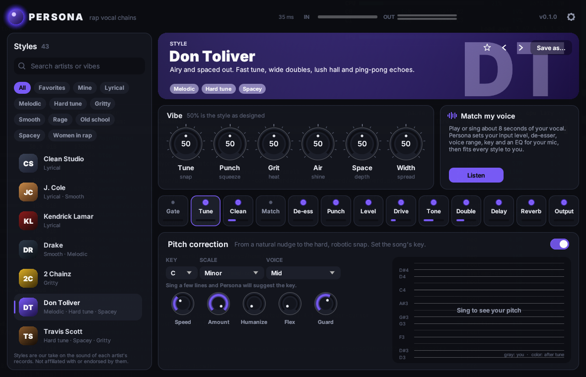

First release of **Persona**, a rap vocal plugin (VST3 + CLAP). Pick an artist's style and Persona sets up the whole vocal chain to sound like their records, then lets you edit every part of it.

## What it does

- **43 styles**: 40 artists plus Clean Studio, Telephone Hook and Ad-lib Space.
  - J. Cole, Kendrick Lamar, Drake, 2 Chainz, Don Toliver, Travis Scott, Future, Lil Baby, Gunna, Young Thug.
  - Lil Uzi Vert, Playboi Carti, Ken Carson, Yeat, Juice WRLD, Lil Wayne, Kanye West, Kid Cudi, Pop Smoke, 21 Savage.
  - Eminem, Nas, Jay-Z, Snoop Dogg, 50 Cent, Tyler, the Creator, Post Malone, Lil Durk, NBA YoungBoy, Rod Wave.
  - Trippie Redd, XXXTentacion, Mac Miller, Denzel Curry, A$AP Rocky, Nicki Minaj, Megan Thee Stallion, Doja Cat, Cardi B and Ice Spice.

  Every style is level-matched, so switching compares sound, not volume.
- **Six vibe knobs**: Tune, Punch, Grit, Air, Space and Width bend the loaded style without touching its settings.
- **Match my voice**: listens to about 8 seconds of your vocal and sets the following:
  - your input level;
  - the de-esser;
  - the tuner's voice range;
  - the key;
  - an EQ for your mic.

  Every style you load afterwards is fitted to your voice.
- **The full chain**, all editable:
  - gate;
  - pitch correction (key, 10 scales, speed, humanize, flex, consonant guard, live pitch display, key suggestion);
  - clean-up EQ and Match EQ;
  - de-esser;
  - FET-style and opto-style compressors;
  - tape / tube / fuzz / phone / lo-fi saturation;
  - tone EQ;
  - doubler;
  - tempo-synced ducking delay;
  - reverb (plate, room, hall, chamber);
  - output with dry/wet and a peak limiter.
- **Browser** with search, tag filters, favorites and your own presets.
- Latency is reported to your DAW: about 2 ms, or 18 to 48 ms with Tune on, depending on the voice range.

Styles are an interpretation of each artist's recorded vocal sound, made as starting points. Persona isn't affiliated with or endorsed by any artist.

## Downloads

| File | For | How to install |
| --- | --- | --- |
| `Persona-0.1.0-windows-x64.zip` | Windows 10/11, 64-bit DAWs | Unzip. Copy `Persona.vst3` to `C:\Program Files\Common Files\VST3` and `Persona.clap` to `C:\Program Files\Common Files\CLAP`, then rescan plugins (FL Studio: *Options > Manage plugins > Find installed plugins*). |
| `Persona-0.1.0-macos-universal.zip` | macOS, Intel and Apple Silicon | Copy to `~/Library/Audio/Plug-Ins/VST3` and `.../CLAP`, then run `xattr -dr com.apple.quarantine` on each (the build isn't notarized). |
| `Persona-0.1.0-linux-x64.zip` | Linux | Copy to `~/.vst3` and `~/.clap`. |
| `SHA256SUMS.txt` | Everyone | Checksums of the zips. |

Put Persona on your vocal's mixer insert. Mono and stereo tracks both work.

## Updating

Persona checks for new releases when it opens and shows an **Update** button in its header. The update is verified against `SHA256SUMS.txt`, replaces the installed files, and is used after your DAW restarts. You can turn the check off under the gear icon.

## Credits

Pitch detection, key detection and PSOLA shifting are ported from [HelixTune](https://github.com/GPTmadeit/HelixTune) (MIT). Built with [nih-plug](https://github.com/robbert-vdh/nih-plug), [egui](https://github.com/emilk/egui) and [RustFFT](https://github.com/ejmahler/RustFFT). [Inter](https://rsms.me/inter/) typeface by Rasmus Andersson (OFL). GPL-3.0-or-later.
