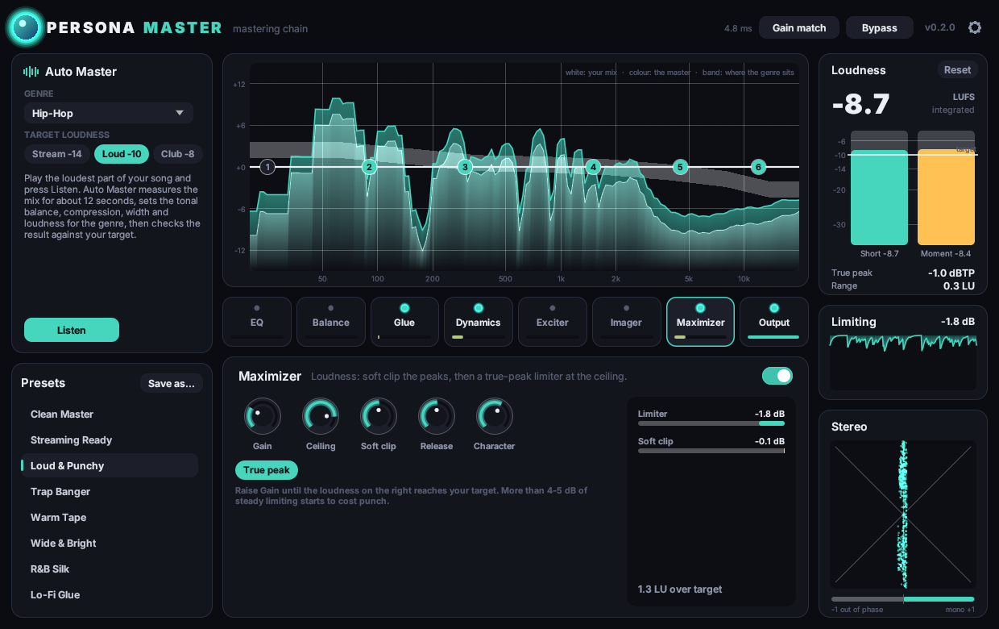

Persona 0.2.0 adds a second plugin: **Persona Master**, a mastering chain for the finished song. It installs with Persona: the same two files now show up as *Persona* and *Persona Master* in your DAW.

## Persona Master

- **Auto Master**: pick a genre and a loudness target, play the loudest part of the song and press *Listen*. It measures the mix for about 12 seconds, then sets these:
  - the tonal balance (eight-band Balance EQ) against the genre;
  - glue and multiband compression from how hard the loud moments hit;
  - stereo width, and mono bass if the low end is wide;
  - the maximizer, then it listens again to land on your loudness target.

  It reports what it did. *Undo* puts everything back.
- **EQ**: six bands, dragged on the analyser, each on the whole mix, the middle or the sides. The filters follow analog curves up to 20 kHz.
- **Glue** bus compressor, four-band **Dynamics**, **Exciter** (tube, tape, crisp) and **Imager** with mono bass.
- **Maximizer**: soft clipper plus a true-peak lookahead limiter.
- **Meters**: integrated, short-term and momentary LUFS, loudness range, true peak (ITU-R BS.1770-4 / EBU R128), limiting history, vectorscope and correlation.
- **Bypass** in time with the master, and **Gain match** to compare at equal loudness. Switch Gain match off before exporting.
- Ten presets (Clean Master, Streaming Ready, Loud & Punchy, Trap Banger, Warm Tape, Wide & Bright, R&B Silk, Lo-Fi Glue, Podcast Voice, Just Limit) and your own.
- Fixed latency of about 5 ms, reported to the DAW.

Ten genres are covered: hip-hop, trap, R&B, pop, EDM, rock, acoustic, lo-fi, podcast and cinematic. The genre targets are our own reading of finished records, meant as starting points.

## Persona (vocals)

- Saturation and the mastering exciter now line up exactly with the dry signal when mixed (a half-sample offset in the oversampler is gone).
- Nothing else changes: your projects and presets load as before.

## What has and hasn't been tested

Tested: 60 unit tests and an offline host that loads the real plugin binary and runs every vocal style and every mastering preset. It checks that the ceiling holds when pushed +15 dB, that Bypass is the exact input delayed by the reported latency, that the state saves and reloads, and that Auto Master lands within 1 LU of the target on a synthetic mix.

Not tested yet: Persona Master inside FL Studio or another DAW on real songs, and on Windows and macOS (those builds come from CI). Please treat the Auto Master result as a starting point and trust your ears.

## Downloads

| File | For | How to install |
| --- | --- | --- |
| `Persona-0.2.0-windows-x64.zip` | Windows 10/11, 64-bit DAWs | Unzip. Copy `Persona.vst3` to `C:\Program Files\Common Files\VST3` and `Persona.clap` to `C:\Program Files\Common Files\CLAP`, then rescan plugins (FL Studio: *Options > Manage plugins > Find installed plugins*). |
| `Persona-0.2.0-macos-universal.zip` | macOS, Intel and Apple Silicon | Copy to `~/Library/Audio/Plug-Ins/VST3` and `.../CLAP`, then run `xattr -dr com.apple.quarantine` on each (the build isn't notarized). |
| `Persona-0.2.0-linux-x64.zip` | Linux | Copy to `~/.vst3` and `~/.clap`. |
| `SHA256SUMS.txt` | Everyone | Checksums of the zips. |

Use **Persona** on the vocal track and **Persona Master** last on the master channel.

## Updating

If you have 0.1.0, press **Update** in Persona's header. It verifies the download against `SHA256SUMS.txt`, replaces the installed files and loads after the DAW restarts. Rescan plugins once so the DAW finds Persona Master.

## Credits

Pitch engine from [HelixTune](https://github.com/GPTmadeit/HelixTune) (MIT). Built with [nih-plug](https://github.com/robbert-vdh/nih-plug), [egui](https://github.com/emilk/egui) and [RustFFT](https://github.com/ejmahler/RustFFT). [Inter](https://rsms.me/inter/) typeface by Rasmus Andersson (OFL). GPL-3.0-or-later.
